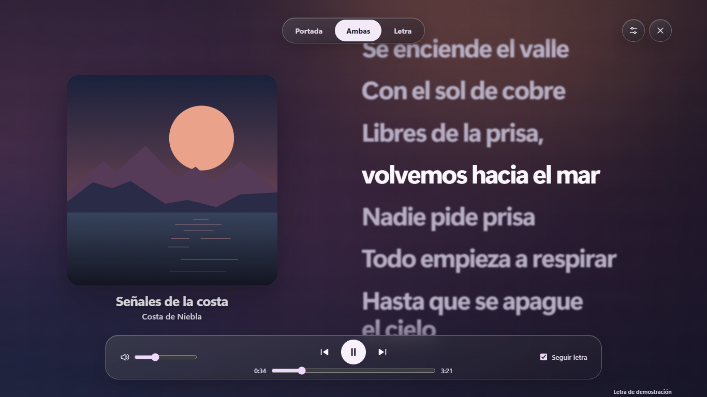
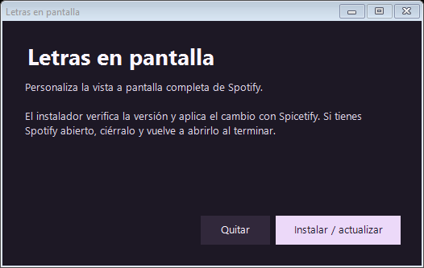
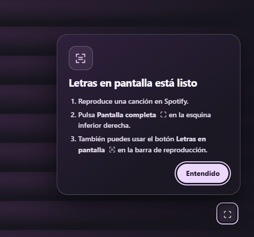

# Spotilyrics

Letras sincronizadas, portadas grandes y fondos en movimiento en la pantalla completa de Spotify para Windows. Elige **Portada**, **Letra** o **Ambas** desde el reproductor.



Las capturas del reproductor usan una portada, una canción y letras de demostración. [Ver modo solo portada](docs/img/solo-portada.png).

## Instalar en Windows

1. Usa **Spotify de escritorio** instalado desde [spotify.com](https://www.spotify.com/download/windows/) y ábrelo al menos una vez. El instalador 1.4.0 admite **Spotify 1.2.14 a 1.3.9** con [Spicetify 2.46.7](https://github.com/spicetify/cli/releases/tag/v2.46.7#compatibility).
2. Descarga `Letras-en-pantalla-1.4.0-Setup.exe` de la [versión 1.4.0](https://github.com/feynnmark/Spotilyrics/releases/tag/v1.4.0). Ejecútalo y pulsa **Instalar / actualizar**. Necesita conexión en el primer uso para descargar la herramienta oficial de Spicetify y verificar su SHA-256.
3. Abre Spotify. Si estaba abierto durante la instalación, ciérralo y vuelve a abrirlo. La primera vez aparece una bienvenida que señala cómo entrar en **Pantalla completa** desde la esquina inferior derecha. También puedes pulsar **Letras en pantalla** en la barra de reproducción.





El instalador usa tu cuenta de Windows actual y conserva tu sesión de Spotify. Marketplace es opcional. Si ya lo tienes, su acceso se oculta por defecto y puedes recuperarlo en **Ajustes → Mostrar acceso a Marketplace**.

Si Spotify se actualiza a una versión fuera del rango, el instalador muestra el motivo y se detiene. La compilación actual carece de firma Authenticode. Puedes comprobar su integridad con `Get-FileHash .\Letras-en-pantalla-1.4.0-Setup.exe -Algorithm SHA256` y comparar el resultado con el archivo `.exe.sha256` de la misma publicación.

### Instalar manualmente

Copia `pantalla-letras.js` a la carpeta `Extensions` de Spicetify. Ejecuta estos comandos y vuelve a abrir Spotify cuando quieras.

```powershell
spicetify config extensions pantalla-letras.js
spicetify backup apply --no-restart
```

Si Spotify ya tiene una copia de seguridad válida de Spicetify y se ha modificado previamente, usa `spicetify apply --no-restart`. Con la CLI instalada también puedes usar `Instalar.cmd` desde una copia local.

## Usar la extensión

- El verso activo se destaca y se desplaza con la sincronización que Spotify trae para esa pista. Haz clic en un verso cuando Spotify permita buscar su posición. Una letra sin marcas de tiempo se muestra para lectura estática.
- Desactiva **Seguir letra** para leer a tu ritmo. Girar la rueda sobre los versos también detiene el seguimiento.
- Los versos ocupan toda la altura disponible y se desvanecen en los bordes. El verso actual queda nítido. Puedes recorrerlos con la rueda o el teclado.
- Ajusta el **Volumen** desde la barra inferior. Los controles se ocultan tras tres segundos de inactividad y vuelven al mover el puntero o pulsar una tecla.
- En **Portada** y **Ambas**, el título y el artista aparecen debajo de la carátula. Al cambiar de canción con **Siguiente** o **Anterior**, la carátula y sus datos se deslizan juntos en la dirección correspondiente, aunque las dos canciones sean del mismo álbum.
- La carátula entra o sale al cambiar entre vistas. La extensión intenta cargar la variante de 640 píxeles del CDN. Si el cliente solo entrega una miniatura, busca la portada del álbum en el oEmbed público de Spotify y conserva la miniatura si falla la consulta.
- En **Ajustes**, elige el fondo y el tamaño de letra. Puedes pausar el movimiento del fondo, desactivar el efecto vidrio y el desplazamiento suave, conservar la vista normal de letras de Spotify y devolver el botón nativo de pantalla completa a su función original. **Letras en pantalla** sigue disponible como botón independiente.
- Pulsa **Esc** o el botón de salida para volver a Spotify. Si el cliente rechaza el modo de pantalla completa del sistema, la vista ocupa su ventana.
- La disponibilidad y los tiempos de las letras dependen de la pista, la cuenta y la interfaz de Spotify. Si una actualización de Spotify cambia esa interfaz, puede aparecer la portada con un aviso de que falta la letra. El reproductor sigue disponible.

## Rendimiento y privacidad

La extensión usa un archivo JavaScript sin dependencias de ejecución. Fuera de la pantalla completa, se limita al botón, los estilos de la vista normal y un controlador de clics. Al cerrar o pasar a un anuncio, desmonta la vista y desconecta sus observadores y eventos de reproducción. **Portada** interrumpe el seguimiento de letras hasta volver a mostrarlas. La ventana oculta suspende sus observadores y el movimiento del fondo. El fondo difumina una copia de 48 × 48 píxeles de la portada una sola vez y después transforma esa copia. Las animaciones respetan la preferencia de movimiento reducido del sistema.

Solo lee las letras que Spotify ya dibuja y mantiene su atribución cuando el cliente la muestra. La portada usa el CDN de Spotify y la búsqueda opcional de una imagen mayor envía únicamente la dirección pública del álbum a Spotify. Guarda las preferencias de apariencia en el cliente. Las letras y portadas pertenecen a sus titulares.

## Quitar la extensión

Ejecuta el mismo instalador, pulsa **Quitar** y vuelve a abrir Spotify. Tus otros complementos se conservan. Con Spicetify también puedes quitarla desde la terminal.

```powershell
spicetify config extensions pantalla-letras.js-
spicetify apply --no-restart
```

Vuelve a abrir Spotify al terminar. Si quieres eliminar el archivo, bórralo de Extensions.

## Compilar y contribuir

En Windows con .NET Framework 4.8, ejecuta `powershell -NoProfile -File .\installer\Build.ps1` desde la raíz. El código del instalador está en `installer/`. La compilación genera el EXE y su SHA-256 en `dist/`. La extensión es `pantalla-letras.js` y su sintaxis se comprueba con `node --check pantalla-letras.js`.

Para reproducir un fallo, incluye la versión de Spotify, la de Spicetify y los pasos. Usa datos de demostración en las capturas. Consulta [Seguridad y privacidad](SECURITY.md) para reportar problemas de seguridad.

El código de Spotilyrics se distribuye con [licencia MIT](LICENSE). Es un proyecto comunitario independiente de Spotify. Usa [Spicetify CLI](https://github.com/spicetify/cli/tree/v2.46.7) como dependencia de instalación.
